# py-obfuscator 保护方案评审材料

| 项 | 内容 |
|---|---|
| **日期** | 2026-10-18 |
| **状态** | 待评审 |
| **版本** | 1.2.0（评审稿 + AI 破解、决策框架、攻击工具链） |
| **用途** | 供方案评审使用，提供背景、候选方案与已知事实 |
| **不含** | 选型结论。取舍由评审者完成 |

**方案编号：** A–H，对应下文八个候选。

---

## 1. 背景：现状与风险

### 1.1 当前发布形态

产品目前只发布字节码文件（`.pyc`）：

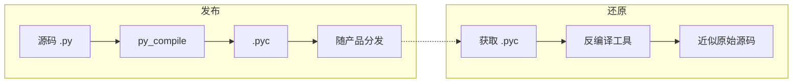

还原之所以可行，是因为字节码保留了完整的控制流、常量表与符号信息，反编译工具可据此转换回可读性很高的源码。转换有损失，但通常足以理解逻辑并复用。

**这一步不需要专业分析能力，只需知道使用哪个工具。** 常用工具及其支持范围：

| 工具 | 支持的 Python 版本 | 说明 |
|---|---|---|
| uncompyle6 | 2.7, 3.3–3.9 | 不支持 3.10 及以上 |
| decompyle3 | 3.8–3.11 | |
| pycdc / pycdas | 2.7–3.x | 高版本支持取决于具体构建 |

> 常被引用的"反编译成功率 95% 以上"来源为 uncompyle6 在 Python 3.9 及以下的实测经验，**对 3.10 及以上不适用**。实际可读性需按目标版本重新实测。

### 1.2 由此产生的风险

| 风险 | 后果 |
|---|---|
| 源码近乎完整暴露 | 业务逻辑、算法实现、内部结构均可被读取 |
| 批量提取成本极低 | 单个脚本即可处理任意数量的 `.pyc`，规模化抄袭几乎没有额外成本 |
| 敏感内容直接可见 | 硬编码常量、接口地址、密钥可被文本扫描直接定位 |
| 维权基础薄弱 | 单一 `.pyc` 是否构成"已采取保护措施"，需法务判断 |

### 1.3 本次评审要回答的问题

> 在现有的离线分发约束下，应选择何种代码保护手段，替代或叠加当前的纯 `.pyc` 形态？

---

## 2. 候选方案

### 2.0 全景与技术构成

| 编号 | 方案 | 代码混淆 | 整体加密 | 原生编译 | 交付物 |
|:---:|---|:---:|:---:|:---:|---|
| **A** | 代码混淆 | ✓ | — | — | `.py` 或 `.pyc` |
| **B** | 二进制加密 | — | ✓ | — | 密文 + 加载器 |
| **C** | 混淆 + 字节码编译 | ✓ | — | — | `.pyc` |
| **D** | 混淆 + 二进制加密 | ✓ | ✓ | — | 密文 + 加载器 |
| **E** | 白盒密码学 | — | ✓（密钥保护） | — | 白盒实例 + 加密载荷 |
| **F** | 现成商业工具（PyArmor） | ✓ | ✓（内置） | — | 混淆产物 + 厂商运行时 |
| **G** | 原生编译（Nuitka） | — | — | ✓ | 可执行文件或 `.so` |
| **H** | C 扩展编译（Cython） | — | — | ✓ | `.pyd` / `.so` |

> "整体加密"指对交付的代码或字节码整体加密。方案 A 中的字符串加密是混淆技术的一种，不属于整体加密。

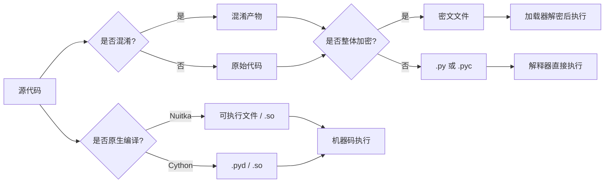

**A 与 C、B 与 D 为何分开。** A 和 B 是变换本身，可作用于任意中间形态；C 和 D 是固定的组合形态：

- A 的输出可以是 `.py` 或 `.pyc`。C 将"仅发 `.pyc`"固定下来，因此多出编译步骤及版本绑定问题。
- B 可加密源码文本或字节码。D 将加密对象固定为"已混淆的字节码"，因此攻击者取得明文后仍是混淆代码。

**E 的定位。** 白盒密码学解决"如何不暴露密钥"，本身不解决"如何分发与执行代码"，因此必须与 B 或 D 组合——由 E 保护解密密钥，由 B/D 负责载荷加密与加载。

**候选来源。** 自研（A–E）、现成工具（F）、原生编译（G、H）。以下方向未纳入，若认为应考虑请提出：运行时自校验、许可证授权体系、核心算法下沉为服务调用（违反离线约束）。

**关于 AI 的影响。** 各方案的 AI 破解路径与门槛统一在 §3 说明。所有相关外部研究均非 Python 环境，其数据只作参考量级，不能作为精确排序依据。

---

### 2.1 方案 A · 代码混淆

**原理：** 在不改变语义的前提下降低代码可读性。

**构建期**

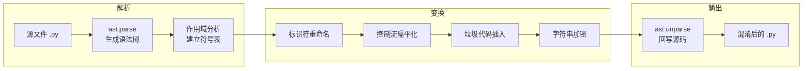

| 变换 | 做什么 |
|---|---|
| 标识符重命名 | 按符号表替换，保留 `__dunder__` 与对外契约名 |
| 控制流扁平化 | 将清晰分支改写为状态机 + 分发循环 |
| 垃圾代码插入 | 插入无副作用的死代码、恒假分支 |
| 字符串加密 | 将字面量替换为运行时解密的调用 |

**目标机**

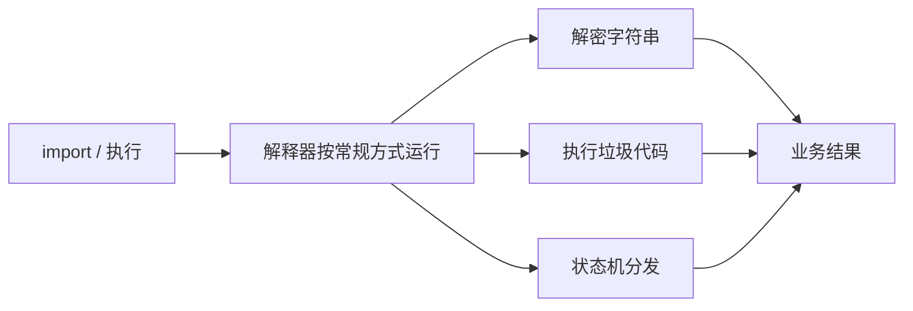

**关键事实**

| 项 | 内容 |
|---|---|
| 交付物与依赖 | `.py` 或 `.pyc`；无第三方依赖 |
| 版本与平台 | 发 `.py` 无绑定；发 `.pyc` 受 CPython 次版本绑定 |
| 性能 | 仅重命名约 0%；含扁平化时视密度而定，热点循环可达数倍 |
| 符号泄漏 | 标识符无意义，但模块结构与控制流完整保留 |
| 主要绕过路径 | 发 `.py` 可直接阅读；发 `.pyc` 则反编译后得到混淆代码 |
| 实现成本 | 四类变换均可基于 `ast` 实现 |

---

### 2.2 方案 B · 二进制加密

**原理：** 加密源码或字节码，运行时解密后加载执行。

**构建期**

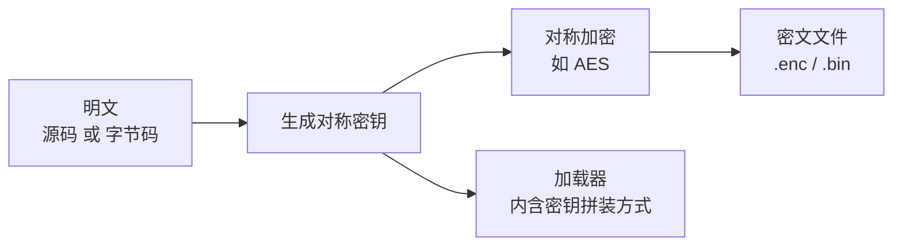

**目标机**

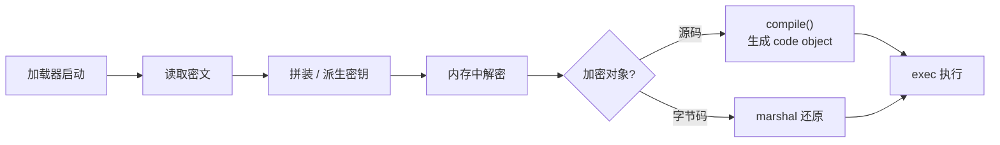

**关键事实**

| 项 | 内容 |
|---|---|
| 交付物与依赖 | 密文文件 + 加载器。标准库不含 AES，需第三方库或自行实现 |
| 版本与平台 | 字节码模式受 CPython 次版本绑定；源码模式不受 |
| 性能 | 启动时一次性解密，通常可忽略 |
| 符号泄漏 | 静态状态不可读；解密后暴露 |
| 主要绕过路径 | 提取密钥自行解密；或直接读取运行时内存 |
| 加载器形态 | 可为纯 Python，也可为自研 C 扩展。后者显著提高密钥提取与批量解密的门槛 |
| 实现成本 | 需处理密钥拼装、内存管理与加载顺序 |

---

### 2.3 方案 C · 混淆 + 字节码编译（`.pyc`）

**原理：** 先混淆，再编译为字节码。

**构建期**

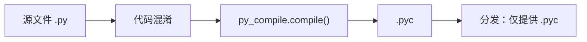

**目标机**


**关键事实**

| 项 | 内容 |
|---|---|
| 交付物与依赖 | 仅 `.pyc`；无第三方依赖 |
| 版本与平台 | 受 CPython 次版本绑定，构建端与运行端必须一致 |
| 性能 | 与方案 A 相同 |
| 符号泄漏 | 反编译后即混淆代码；标识符无义但结构完整 |
| 主要绕过路径 | `.pyc` → decompyle3 / pycdc → 混淆后的可读代码 |
| 实现成本 | 混淆实现 + 一次编译调用 |

---

### 2.4 方案 D · 混淆 + 二进制加密

**原理：** 先混淆，再加密，运行时由加载器解密执行。

**构建期**

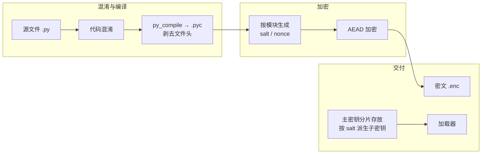

**目标机**（以 import hook 方式为例）

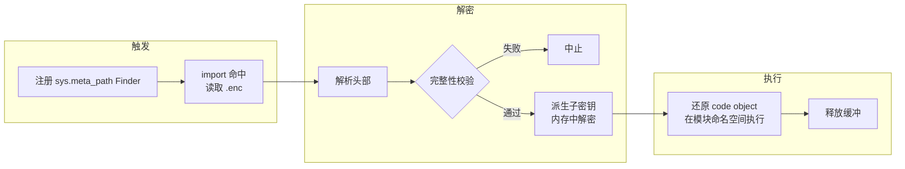

**关键事实**

| 项 | 内容 |
|---|---|
| 交付物与依赖 | `.enc` 文件 + 加载器；加载器若为原生扩展则需分平台构建 |
| 版本与平台 | marshal 格式绑定 CPython 次版本；原生加载器另需绑定 OS 与 CPU 架构 |
| 性能 | 一次性解密 + 常驻 import hook；相对 A/C 有额外开销 |
| 符号泄漏 | 静态不可读；解密后仍是混淆代码 |
| 主要绕过路径 | 提取密钥 → 解密 → 再反编译；或读取运行时内存中的 code object |
| 实现成本 | 最高一档：import hook、密钥派生、完整性校验、跨平台构建 |
| 加载器形态 | 可为纯 Python 或自研 C 扩展；后者显著提高密钥提取与批量解密的门槛 |

---

### 2.5 加载器实现形态：纯 Python 与 C 扩展

方案 B 与 D 都需要一个加载器。加载器有两种实现路径，两者的成本与防护效果差异明显，因此单独列出供评估。

#### 2.5.1 两种形态

**纯 Python 加载器。** 加载器本身是普通 Python 模块，负责读取密文、派生子密钥、解密并执行。实现上只需 `importlib` 与标准库。

**C 扩展加载器。** 加密、解密与密钥管理全部由自研原生扩展承担，Python 层只保留一行引导代码，不持有解密能力。

两种形态的构建期流程完全相同，差别只在加载器本身。

#### 2.5.2 优缺点对照

| 维度 | 纯 Python 加载器 | C 扩展加载器 |
|---|---|---|
| **密钥保护** | 弱。密钥拼装逻辑以字节码形式交付，反编译即可还原，LLM 可加速 | 较强。需原生逆向 + 动态跟踪才能定位密钥 |
| **批量解密门槛** | 低。解密接口在 Python 层暴露，可被脚本直接批量调用 | 较高。接口不暴露解密函数，无法作为黑盒复用 |
| **加密算法选择** | 受标准库限制。标准库无 AES，只能用 `hashlib` 构造流加密 | 可内嵌任意算法（如 ChaCha20-Poly1305），无外部依赖 |
| **构建成本** | 低。一次编写，全平台通用，无需 C 工具链 | 高。按 OS × 架构 × Python 小版本分别编译，并需持续回归 |

#### 2.5.3 结论性判断

两者的实质差异只有两处：**密钥能否被反编译得到**，以及**解密能力能否被脚本批量复用**。C 扩展在这两点上都更强，代价是构建矩阵与维护成本。

其余方面两者一致——都不改变"运行时内存可读"这一边界，也都需要随软件分发密钥材料。选择哪种形态，实际上是在"密钥提取门槛"与"构建维护成本"之间取舍。

#### 2.5.4 C 扩展形态的简要方案

以下是 C 扩展形态的具体构成，供评估其可行性。

**定位。** Python 层不持有解密能力，只保留一行引导。

**交付结构**

```
app/
  main.pyc                                  入口，仅一行引导
  appsec.cp311-win_amd64.pyd                Windows 构建
  appsec.cpython-311-x86_64-linux-gnu.so    Linux 构建
  pkg/
    core.enc                                 各模块密文
    util.enc
```

`.pyd` / `.so` 按"平台 + Python 小版本"命名，`import appsec` 时解释器自动选择当前平台的二进制。

**内部模块划分**

| 文件 | 职责 |
|---|---|
| `appsec.c` | `PyInit_appsec`：版本校验，暴露唯一接口 `install(prefix)` |
| `hook.c` | 注册 `sys.meta_path` finder（以 C 实现，非 Python 类） |
| `encfile.c` | `.enc` 头解析、完整性 tag 校验 |
| `crypto.c` | ChaCha20-Poly1305（内嵌公有领域实现，无外部依赖） |
| `keyring.c` | 密钥分片拼装，按模块 salt 派生子密钥 |

**执行路径**

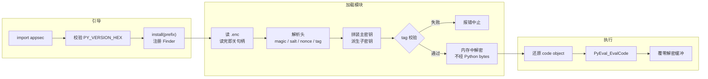

**关键约束**

- **CPython 小版本绑定。** marshal 格式与所用 C-API 均绑定小版本。`PyInit_appsec` 校验 `PY_VERSION_HEX`，不匹配时直接抛 `ImportError`，而非运行到中途崩溃。
- **需分平台构建。** Windows 用 MSVC，Linux 用 gcc；Linux 侧建议在容器中构建以控制 glibc 版本下限。加密一次，各平台分别编译。
- **只用公开稳定 C-API。** Linux 下采用"不链接 libpython、符号由宿主解释器解析"的标准扩展模式。
- **构建工具链属构建期依赖**，不进入交付物。

**边界。** 原生扩展把密钥提取与批量解密的门槛从脚本级抬到原生逆向级，同时解决了标准库没有 AES 的问题。但它不改变"运行时内存可读"这一固有边界——这一点与实现语言无关。

---

### 2.6 方案 E · 白盒密码学

**原理：** 将密钥溶解进算法实现，使交付物中不存在独立密钥值。用于保护 B/D 的解密密钥。

**构建期**


**目标机**


**关键事实**

| 项 | 内容 |
|---|---|
| 交付物与依赖 | 白盒实例 + 加密载荷；需第三方白盒库或自研编译器级支持 |
| 版本与平台 | 取决于所选库 |
| 性能 | 查表运算，通常比常规实现慢 1–2 个数量级 |
| 保护对象 | 仅密钥，不保护代码逻辑——代码仍需 B/D 的加载与执行机制 |
| 主要绕过路径 | 针对白盒实现的专门攻击；或绕过密钥直接从运行时内存取明文 |
| 实现成本 | 最高一档，且依赖外部实现质量 |

---

### 2.7 方案 F · 现成商业工具（以 PyArmor 为代表）

**原理：** 采购成熟的商业混淆工具，而非自研。

**构建期**

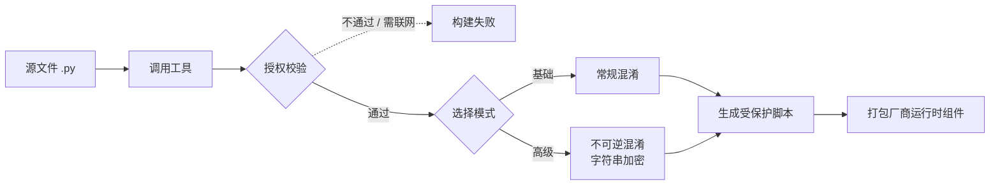

**目标机**


**关键事实**

| 项 | 内容 |
|---|---|
| 交付物与依赖 | 混淆产物 + 厂商运行时组件（需随交付物分发） |
| 版本与平台 | 运行时组件按 Python 版本与平台分发；具体支持范围需向厂商确认 |
| 性能 | 无公开的独立评测数据，需自行基准测试 |
| 保护强度 | 取决于所选模式；厂商声称高级模式不可逆，无公开的独立验证 |
| 主要绕过路径 | 取决于模式；需用自有样本实际验证 |
| **构建条件** | **Basic / Pro 授权在混淆时需联网验证许可**；仅更高等级授权支持完全离线 |
| 长期可用性 | 厂商已多次更换授权体系；当前版本授权不保证兼容未来版本 |

---

### 2.8 方案 G · 原生编译（Nuitka）

**原理：** 将 Python 整体翻译为 C 代码再编译为机器码，交付物中不再包含 Python 字节码。

**构建期**

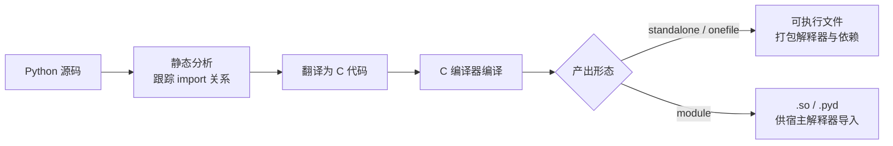

**目标机**

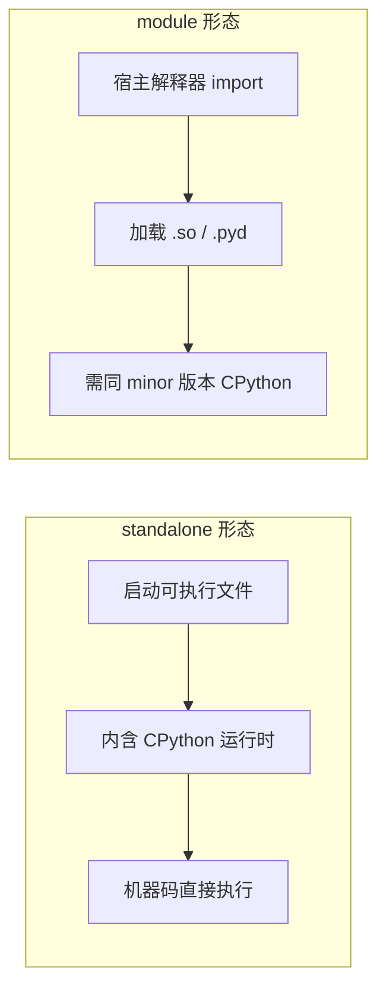

**关键事实**

| 项 | 内容 |
|---|---|
| 交付物与依赖 | 可执行文件（自包含）或 `.so`/`.pyd`；需分平台构建 |
| 版本与平台 | standalone：不依赖目标机的 Python 版本，但绑定 OS 与 CPU 架构；module：另需绑定 CPython 次版本 |
| 性能 | 通常优于解释执行；需实测确认 |
| 符号泄漏 | 无 Python 字节码；但字符串常量与模块结构仍可被提取 |
| 主要绕过路径 | 原生逆向；另有社区工具可静态提取其中的常量与结构 |
| 构建条件 | 需 C 编译器工具链；全量编译耗时远长于 `py_compile` |
| 实现成本 | 高：分平台构建矩阵 + 动态特性适配 |

---

### 2.9 方案 H · C 扩展编译（Cython）

**原理：** 将模块编译为 `.pyd` / `.so`。

**构建期**

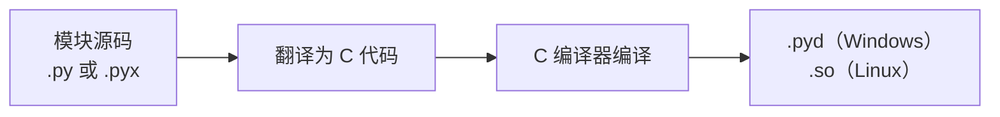

**目标机**


**关键事实**

| 项 | 内容 |
|---|---|
| 交付物与依赖 | `.pyd` / `.so`；需分平台构建，无运行时第三方依赖 |
| 版本与平台 | 绑定 CPython 次版本 + OS + CPU 架构 |
| 性能 | 通常不劣于解释执行；类型标注得当可显著更快 |
| 符号泄漏 | 编译产物中 CPython API 调用痕迹明显，字符串与常量表仍可读 |
| 主要绕过路径 | 原生逆向；常量与结构比方案 G 更易提取 |
| 构建条件 | 需 C 编译器工具链，部分模块需改写为 `.pyx` |
| 实现成本 | 中等；可按模块逐步推进 |

---

### 2.10 横向对照

| 方案 | 新增运行时层 | 交付物含可读符号 | 需宿主 Python | 版本 / 平台绑定 |
|:---:|:---:|:---:|:---:|---|
| A 代码混淆 | 否 | 部分 | 是 | 发 `.py` 无；发 `.pyc` 绑次版本 |
| B 二进制加密 | 是（解密） | 否 | 是 | 源码模式无；字节码模式绑次版本 |
| C 混淆 + `.pyc` | 否 | 部分 | 是 | 绑次版本 |
| D 混淆 + 二进制 | 是（解密） | 否 | 是 | 绑次版本；原生加载器另绑平台 |
| E 白盒密码学 | 是（查表） | 否 | 是 | 视库而定 |
| F 商业工具 | 是 | 否 | 是 | 视厂商支持范围 |
| G 原生编译 | 否 | 部分 | standalone 否；module 是 | standalone 绑平台；module 另绑次版本 |
| H 扩展编译 | 否 | 部分 | 是 | 绑次版本 + OS + 架构 |

### 2.11 混淆技术的性能代价（待实测）

方案 A、C、D 共用以下技术：

| 技术 | 开销来源 | 预估量级 | 说明 |
|---|---|---|---|
| 标识符重命名 | 无 | 约 0% | 仅改变符号名 |
| 字符串加密 | 每次使用时的运行时解密 | 低 | 是否缓存影响很大；循环内重复解密会放大 |
| 垃圾代码插入 | 无效指令执行、体积膨胀 | 低至中 | 与插入密度成正比；密度的分母定义待明确 |
| 控制流扁平化 | 状态机分发、额外分支 | 中至高 | 对计算密集型热路径影响最大，热点循环可达数倍 |

> 以上均为量级估计，无实测支撑。在 20% 的统计口径与基准测试集确定前，不能作为决策依据。

---

## 3. AI 对各方案的破解

本章把原先分散在 §2 各方案小节中的"对 AI 的防护"内容集中于此，统一回答一个问题：**面对具备工具链的 AI 攻击者，每个方案的破解路径与门槛是什么。**

> **阅读前提：** 外部研究均非 Python 环境（见 3.1），其数据只作参考量级，不能作为精确排序依据。真正区分各方案的是结构性事实——密钥是否随软件分发、内存是否可读、字节码是否可还原——这些不依赖实验。

### 3.1 证据边界

现有 AI 破解研究存在三项系统性偏差，使结论**偏乐观**（对防护方不利）：

| 偏差 | 说明 |
|---|---|
| 语言不匹配 | 实验对象是 C 程序或通用原生二进制，**不是 Python / `.pyc`** |
| 模型非最强 | 评测所用模型均非当时最强 |
| 经过微调 | 部分实验对模型做了针对任务的微调 |

因此，本材料中所有量化的 AI 结论只能作为参考量级。Python 环境下的实际还原能力必须通过 §6.2 第 5 项的还原测试集实测（对应假设 A7）。

### 3.2 通用准则：绕开而非破解

一项针对性实验（Quarkslab，2026-08）显示，具备完整工具链的自主 agent **未正面破解任何一层保护，而是逐层绕开**：静态分析受阻时，转为提取代码片段、移植为可执行形式后运行取结果。

据此可归纳一条准则：**只要某个秘密能通过"静态读出 + 移植执行"获得，混淆这一层就会被绕开。** 对代码逻辑本身而言，这条准则意味着混淆主要抬高阅读成本，不构成阻断。

这条准则对四类方案的含义不同：

| 方案类型 | 静态读出是否可行 | 移植执行是否可行 | 结论 |
|---|---|---|---|
| 混淆 `.py` / `.pyc`（A/C） | 可行（直接阅读或反编译） | 可行 | 绕开成本最低 |
| 加密 + 加载器（B/D） | 需先提取密钥 | 可行（解密后） | 绕开成本取决于密钥提取门槛 |
| 原生编译（G/H） | 可提取常量与结构 | 可行（逆向机器码） | 绕开成本最高，但仍非阻断 |
| 白盒（E） | 密钥非独立变量 | 可行（内存 dump） | 绕开成本取决于白盒实现 |

### 3.3 分方案分析

#### 3.3.1 方案 A · 代码混淆

混淆后的 `.py` 是文本，静态读取无门槛。攻击者的核心工具是 LLM 本身——将混淆代码贴入 LLM 要求解释逻辑，LLM 在标识符推断与控制流理解上是其强项。

有一项系统性评测（arXiv:2511.19130v1，2025-11，预印本，未经同行评审）可作参考。该评测用四种变换处理 170 段 C 程序，测量 LLM 的**语义保真度**（还原结果与原始代码的一致程度，0–100）：

| 混淆技术 | 语义保真度 | 对 LLM 的难度 |
|---|---|---|
| 算术编码（将简单表达式改写为等价的复杂形式） | 94.7 | 低 |
| 分支编码（将判断条件改写为间接形式） | 83.6 | 中低 |
| 控制流扁平化 | 79.0 | 中 |
| 不透明谓词（恒真或恒假、但形式复杂的条件） | 68.0 | 高 |

对方案 A 的四项技术而言：

| 技术 | 情况 |
|---|---|
| 标识符重命名 | 无数据（未纳入上述评测）。让 LLM 推断标识符含义是其强项 |
| 控制流扁平化 | 保真度 79.0，比传统预期更易还原 |
| 垃圾代码插入 | 无数据 |
| 字符串加密 | 无数据 |

> **注意：** 不透明谓词不在方案 A 的技术清单内，但抗性最高（68.0）。是否将其纳入混淆手段，可能比选择哪个方案更影响实际效果。

#### 3.3.2 方案 B · 二进制加密

本方案不提高静态分析难度，而是把攻击引向密钥提取。关键在于：**加密有效的前提是密钥无法被静态提取，而本项目不满足该前提**——密钥必须随软件分发，且程序运行时内存中必然存在已解密内容。攻击者（无论人或 AI）可直接提取密钥自行解密，无需攻破加密算法本身。

这一点属于结构性事实，由本项目的交付模式直接推出，不依赖任何外部实验。AI 的自动化能力只是把这条既有路径执行得更快。

> **结论：** 对 AI 而言，本方案的门槛不在于算法强度，而在于密钥提取的工作量。该工作量取决于加载器实现（见 3.3.4 与 §2.5）。

#### 3.3.3 方案 C · 混淆 + 字节码编译（`.pyc`）

`.pyc` 这一层对 LLM 不构成障碍——反编译是确定性的。因此本方案的实际破解难度**几乎完全等同于方案 A 的混淆成分**，其效果取决于所选混淆技术，而非编译这一步。

对三类攻击者的差别：顺手抄袭者仍会因产物不可直接复用而放弃；批量提取与有决心的攻击者面对的仍是混淆代码，其难度与方案 A 一致。

> **待实证：** 相对方案 A，"多一道编译"是否真的带来额外防护。反编译是确定性的，第二道门槛未必增加语义分析难度。不应凭直觉假定。

#### 3.3.4 方案 D · 混淆 + 二进制加密

与方案 B 相比多一层混淆：攻击者即便取得了明文，面对的仍是难读的代码，仍需重建语义。因此本方案同时具备"密钥提取门槛"与"代码阅读门槛"两层。

但**两层都不是阻断**：

- 密钥提取这一层受项目结构性条件限制（密钥必须随软件分发、运行时内存必然存在明文），与方案 B 相同。
- 代码阅读这一层取决于混淆技术，其效果与方案 A 相同。

对批量提取的额外意义：脚本或 AI 若要批量处理，必须先解决密钥与加载器，单次成本会被放大到每个模块。这是本方案相对 A/C 的主要差异。

#### 3.3.5 方案 E · 白盒密码学

本方案与 LLM 阅读代码的能力关系不大——它改变的是密钥提取门槛，而非代码可读性。

白盒消除了独立密钥变量，在设计意图上提高密钥提取成本。但它不是例外：攻击者仍可能恢复等价密钥材料，或绕过密钥直接从内存取明文。区别在于成本更高，而非不可行。

对 AI 的具体意义：若密钥提取原本只是一次静态读取，白盒会将其变为需要理解查表结构的工作；但对于能够运行程序并观察内存的自动化工具，这条捷径仍然存在。

#### 3.3.6 方案 F · 现成商业工具（以 PyArmor 为代表）

无公开的独立评测数据。厂商声称高级模式不可逆，但没有可供核实的第三方结果，本材料无法判断其对批量提取与有决心攻击者的实际效果。

厂商文档承认不擅长内存保护与反调试，这与自研路线面临的边界相同，不构成差异。

> 建议在评审中安排一次针对自有样本的验证，而非依赖厂商声明。

#### 3.3.7 方案 G · 原生编译（Nuitka）

本方案改变了攻击者所需的技能栈——从"还原字节码"变为"逆向机器码"。这是本方案与其他候选最本质的差异。

但需注意两点：

- 现有 AI 逆向实验的对象是通用原生二进制，**不是 Nuitka 产物**，因此相关结论不能直接套用到本方案。原生二进制是当前唯一有公开 AI 辅助逆向数据的形态，这是可利用的信息，但不构成对本方案效果的证明。
- 社区已有针对 Nuitka 产物的静态解包与常量提取工具（见 §8.2.4）。实际门槛需实证评估，不能仅凭"原生编译"这一属性推定安全性。

对批量提取的意义：若提取工具可用，批量处理仍然可行；改变的主要是单次逆向的技能要求。

#### 3.3.8 方案 H · C 扩展编译（Cython）

与方案 G 同属原生路线，但符号残留更多：编译产物中 CPython API 调用痕迹与常量表仍清晰可读，因此静态提取的难度低于 Nuitka 产物。

同样地，现有 AI 逆向实验对象不是 Cython 产物，相关结论不能直接套用。本方案的实际 AI 抗性需以自有样本实测。

适用上的差异：本方案按模块推进，可用于"只对核心模块加强"的分层做法；此时只有被编译的模块获得原生门槛，其余部分仍处于混淆或明文的保护水平。

### 3.4 LLM 去混淆研究现状

近年研究显示 LLM 在去混淆任务上进展迅速，但存在明确边界：

| 研究 | 对象 | 结论 |
|---|---|---|
| arXiv:2511.19130（2025-11，预印本） | C 程序，四种混淆技术 | 不透明谓词保真度最低（68.0），控制流扁平化中等（79.0） |
| arXiv:2505.19887（DIMVA 2025） | 汇编代码，OLLVM 混淆 | 三档分型：虚假控制流（低抗性）、扁平化（中）、指令替换/组合（高）；LLM 对组合技术普遍失败 |
| LLM4DOBF（IEEE 2025） | Tigress / OLLVM 混淆代码 | LLM 经专门训练后可处理复杂混淆，但需 fine-tuning |
| BinDeObfBench（2025） | 二进制去混淆基准 | 伪代码输入优于原始汇编；任务特定 fine-tuning 显著提升效果 |

**对本项目的启示：**

- LLM 对**组合式混淆**（多种技术叠加）的还原能力显著下降，单一技术容易还原
- 不透明谓词在多项研究中均为抗性最高的单项技术
- 所有研究均在 C/汇编层面，Python 层面无数据（假设 A7）
- LLM 辅助攻击降低了"静态读取 + 理解"的门槛，但**不改变内存 dump 路径**——这条路径不需要理解代码，只需读取内存

> **设计准则（重申 3.2）：** 只要某个秘密能通过"静态读出 + 移植执行"获得，混淆这一层就会被绕开。LLM 加速的是"静态读出 + 理解"这一环节，对需要原生逆向或内存 dump 的路径影响有限。

### 3.5 横向小结

| 方案 | AI 破解主要路径 | 相对门槛 | 关键变量 |
|:---:|---|---|---|
| A 代码混淆 | LLM 直接阅读 + 语义重建 | 最低 | 混淆技术对 LLM 的抗性（无 Python 数据） |
| C 混淆 + `.pyc` | 反编译 → 同 A | 与 A 相同 | 反编译工具对目标版本的支持度 |
| B 二进制加密 | 提取密钥 → 解密 | 中，取决于加载器 | 密钥提取门槛 |
| D 混淆 + 二进制 | 提取密钥 → 解密 → 同 A | 高于 A/B | 密钥提取门槛 + 混淆抗性 |
| E 白盒密码学 | 恢复等价密钥或内存 dump | 高（密钥层面） | 白盒实现质量 |
| F 商业工具 | 取决于模式 | 无独立数据 | 需自有样本验证 |
| G Nuitka | 原生逆向 / 社区解包工具 | 高 | 产物提取工具成熟度（待实测） |
| H Cython | 原生逆向 / 常量提取 | 中高 | 符号残留多，抽取更易 |

> **小结：** 从 AI 破解的角度，方案间的主要差异不在"能不能破"，而在"需要走多远"。混淆类（A/C）的差异来自技术选择；加密类（B/D）的差异来自加载器形态；原生类（G/H）的差异来自逆向成本。任何方案都不改变"运行时内存可读"这一共同边界（见 §4）。

---

## 4. 共同边界

以下不是某个方案的缺点，而是八个方案共同的上限。

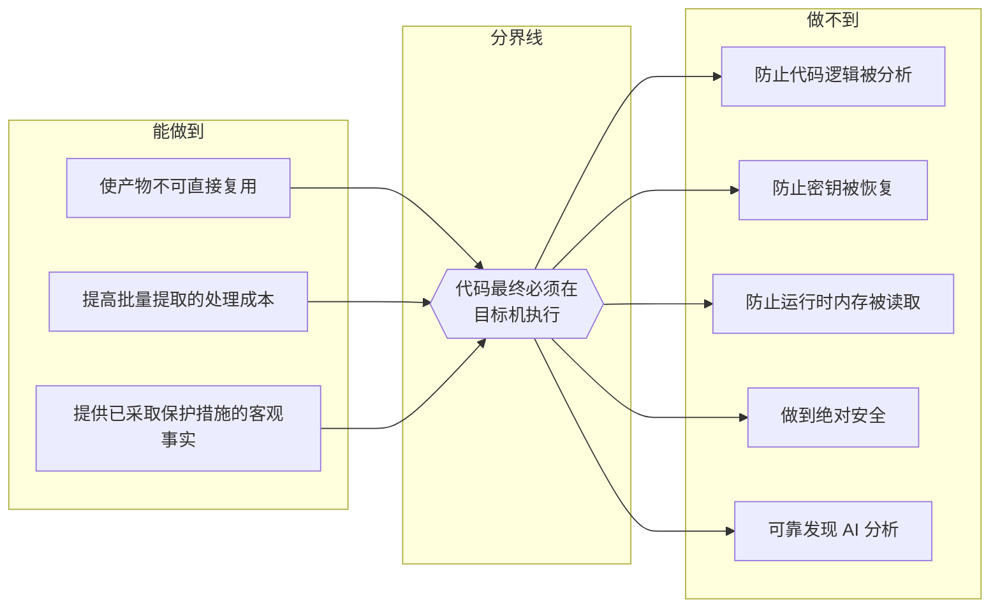

> 第三项"已采取保护措施"这一事实与保护强度无关，但其是否构成法律意义上的"合理保密措施"，需法务判断。

### 4.1 三个需要澄清的常见预期

**"改用原生扩展可以防止内存被读取"——不能。** 原生方案确实不再有 Python code object，但机器码、常量表与解密后的数据同样存在于进程内存中。

**"加密强度越高越安全"——在内存读取面前不成立。** 若防护目标包含"防止运行时代码被提取"，现有候选均无法满足。

**"白盒可以使密钥绝对不可提取"——不能。** 白盒消除的是独立密钥变量，攻击者仍可能恢复等价密钥材料。

---

## 5. 关键假设

以下是本材料的事实基础。其成立与否会显著改变各方案的相对价值排序，请逐条确认。

| 编号 | 假设 | 若不成立的影响 | 验证方式 |
|---|---|---|---|
| **A1** | LLM 能较快还原常见混淆技术的语义，使"拖延时间"失去区分度 | 若还原能力弱于预期，时间维度恢复有效，混淆类方案价值上升、原生编译类优势下降 | 混淆样本 + LLM 还原测试 |
| **A2** | `.pyc` 可被高成功率反编译 | 若目标版本为 3.10 及以上且工具支持不佳，现状比预期安全，各方案相对收益均下降 | 按目标版本实测 decompyle3 / pycdc |
| **A3** | 混淆带来的性能开销在 20% 预算内 | 需在"降低强度"与"热点豁免"间取舍，而热点豁免依赖假设 A4 | 建立基准集实测 |
| **A4** | 存在可行的热点代码识别方法 | 只能全量施加（可能超预算）或人工标注（难以长期维护） | 评估自动分析 / 静态启发式 / 人工标注三条路径 |
| **A5** | 产品不需要保护随软件分发的密钥 | 若确实需要，加密类方案的结构性缺陷即为致命，需求需重新定义 | 梳理敏感资产清单及保护要求 |
| **A6** | 主要威胁来自顺手抄袭者 | 若主要威胁实为有决心的攻击者，抬高门槛的边际收益很低，应偏向原生编译类 | 补充威胁情报或业务侧输入 |
| **A7** | 现有 AI 破解研究的结论可外推到 Python / `.pyc` | 若不能外推，本材料中所有量化的 AI 结论均失效，仅剩结构性推理可用 | 必须在 Python 环境实测 |
| **A8** | 防护力主要由具体技术组合决定，而非方案编号 | 若按方案整体决策，候选方案的组织方式需调整 | 评审时确认决策粒度 |

**A1 与 A7 需分开理解：** A7 判断外部实验能否用于本项目（目前不能，因为实验既非在 Python 上完成，也非针对 `.pyc`）；A1 判断即使能外推、结论是什么（目前只有部分技术有数据）。因此在 Python 实测完成前，关于 AI 还原能力的量化数据只能作为参考量级。

**A5 与"实际要保护什么"这一开放问题绑定。** A5 是待确认的前提而非结论。若该问题的答案为"保护写在代码中的秘密"，则 A5 不成立，整份材料的前提需重新评估。

---

## 6. 待补数据与开放问题

### 6.1 需业务侧输入

| # | 问题 | 影响 |
|---|---|---|
| 1 | 实际要保护什么？防功能抄袭 / 保护特定算法 / 保护嵌入的秘密 / 满足合规要求 | 不同答案指向完全不同的方案；若为"保护秘密"，假设 A5 不成立 |
| 2 | 主要威胁来源是谁 | 决定各方案防护重点 |
| 3 | 构建环境能否联网 | 决定方案 F 是否可用 |
| 4 | 目标 Python 版本与操作系统范围 | 决定各方案的版本/平台绑定成本 |

### 6.2 需实测补充的数据

| # | 数据 | 说明 |
|---|---|---|
| 5 | **LLM 对候选技术的实际还原能力** | 现有证据全部来自 C 语言与通用原生二进制，未在 Python 环境验证。这是本材料最大的数据缺口 |
| 6 | 目标版本下 `.pyc` 的反编译成功率与产物可读性 | 现有高成功率数据基于 3.9 及以下，3.10 以上存疑 |
| 7 | 各方案的实际性能开销 | 当前表格中的数字无实测支撑 |
| 8 | 垃圾代码插入、字符串加密的 AI 抗性 | 无数据 |
| 9 | 若考虑方案 G：Nuitka 产物的实际提取难度 | 已有社区工具，需评估真实门槛 |
| 10 | 若考虑方案 F：对自有样本的实际保护效果 | 需独立验证 |

> **第 5 项建议方法：** 取本项目代表性代码，分别施加各类混淆技术（重命名、控制流扁平化、垃圾代码插入、字符串加密，外加评测中表现最好的不透明谓词），交由 LLM 做语义还原，记录成功率与耗时。

### 6.3 需在方案中明确、但本材料不代为裁决

| # | 问题 |
|---|---|
| 11 | 热点代码识别方法——是分级施加保护能否执行的前提 |
| 12 | 混淆后的调试支持：是否保留行号与符号映射；若保留，映射表是否随软件分发，历史版本如何归档 |
| 13 | 混淆是否破坏所用 Python 动态特性。可能受影响的机制包括按名称动态查找、动态执行、装饰器、反射、对象序列化、字段名等 |

---

## 7. 评审决策框架

§6 列出了 12 个开放问题，但它们是并列的，评审者读完后仍缺少"先确认什么、再选什么"的操作路径。本节把问题组织成决策树，使评审产出从"A–H 八个方案摆出来"变为"给定前提，走这条路径"。

### 7.1 决策路径

```mermaid
flowchart TD
    START["评审起点"] --> Q1{"Q1 实际保护目标?"}

    Q1 -->|"防功能抄袭"| P1["混淆路线 A/C/D"]
    Q1 -->|"保护特定算法"| P2["算法下沉: C扩展 H 或服务化"]
    Q1 -->|"保护嵌入秘密"| P3["前提不成立 A5<br/>需重新定义需求"]
    Q1 -->|"满足合规要求"| P4["优先合理保密措施<br/>客观证据,强度次要"]

    P1 --> Q2{"Q2 目标 Python 版本?"}
    P2 --> Q2
    P4 --> Q2

    Q2 -->|"3.9 及以下"| R1["pyc 反编译风险高<br/>C/D 形态价值大"]
    Q2 -->|"3.10 及以上"| R2["反编译工具支持差<br/>现状已有一定基础"]
    Q2 -->|"standalone 无绑定"| R3["Nuitka 不依赖目标机 Python"]

    R1 --> Q3{"Q3 主要威胁者?"}
    R2 --> Q3
    R3 --> Q3

    Q3 -->|"顺手抄袭者"| S1["任何形态都够用<br/>选成本最低的"]
    Q3 -->|"有决心的攻击者"| S2["原生编译 G/H<br/>或 C 扩展加载器 D-cext"]
    Q3 -->|"两者兼有"| S3["分层: 核心走原生<br/>其余走混淆+加密"]

    S1 --> Q4{"Q4 性能预算口径?"}
    S2 --> Q4
    S3 --> Q4

    Q4 -->|"整机端到端 20%"| T1["高强度手段受限<br/>需热点豁免"]
    Q4 -->|"关键路径 20%"| T2["多数代码可承受高强度<br/>仅热点豁免"]
    Q4 -->|"口径未定"| T3["先留机制,实测后定阈值"]
```

### 7.2 决策分支映射表

每条路径的关键变量、需优先确认的假设与剩余风险：

| 决策分支 | 推荐路径 | 关键变量 | 需优先确认的假设 | 剩余风险 |
|:---:|---|---|---|---|
| 防功能抄袭 · ≤3.9 · 顺手抄袭者 | A 或 C | 混淆技术对 LLM 的实际抗性 | A1, A2 | 还原测试数据缺失 |
| 防功能抄袭 · ≥3.10 · 顺手抄袭者 | A | 同上 | A1 | 同上 |
| 防功能抄袭 · 有决心攻击者 | D-cext 或 G | 密钥提取门槛、Nuitka 产物提取难度 | A6, A7 | 原生逆向成本未量化 |
| 保护特定算法 · 有决心攻击者 | H（核心模块） | 算法耦合度、Cython 改写成本 | A4 | 动态特性兼容性 |
| 保护嵌入秘密 | — | A5 不成立 | A5 | 需求需重新定义 |
| 合规要求 | 任意 + 溯源水印 | "合理保密措施"的法务判定 | A6 | 强度非首要 |
| 分层 · 核心原生 + 其余混淆加密 | D-cext + H 组合 | 分层边界划定、构建复杂度 | A4, A6 | 维护两套流水线 |

> **决策粒度提醒（假设 A8）：** 防护力主要由具体技术组合决定，而非方案编号。上表的"推荐路径"是起点，不限制在单一方案内组合技术。

### 7.3 决策前置条件

在进入 §7.1 的决策路径之前，需先确认以下三项，否则路径分支会悬空：

| # | 前置条件 | 对应 §6 项 | 未确认的影响 |
|---|---|:---:|---|
| P1 | 实际保护目标 | §6.1 第 1 项 | Q1 无法选择，后续全部悬空 |
| P2 | 目标 Python 版本与 OS 范围 | §6.1 第 4 项 | Q2 无法选择，C/D/G/H 的绑定成本无法评估 |
| P3 | 威胁者画像 | §6.1 第 2 项 | Q3 无法选择，"顺手抄袭者 vs 有决心攻击者"的取舍无法定 |

这三项确认后，§7.1 的决策路径可一次走完，产出明确的选型方向。§6.2 的实测数据（第 5、6 项）用于回填各方案的实际防护力，不影响路径选择本身。

---

## 8. 各形态攻击工具链

§1.1 对 `.pyc` 的反编译工具做了调研，但其他形态的攻击侧工具基本未提。本节补齐这一缺口，使评审者对"各形态真实门槛"有具体画面，而非停留在抽象判断。

> **证据边界：** 以下工具均为公开可得，不存在需要"专业能力"才能获取的门槛。门槛在于使用这些工具所需的技能栈与工作量，而非工具本身的稀缺性。

### 8.1 工具链总览

| 形态 | 静态提取工具 | 动态提取工具 | 技能门槛 | 材料原覆盖 |
|---|---|---|---|:---:|
| 纯 `.pyc` | decompyle3 / pycdc / uncompyle6 | 不需要 | 脚本级 | ✅ |
| A 混淆 `.py` | AST unparser、文本扫描 | `python -c` 动态观察、LLM 分析 | 脚本级 | ❌ |
| C 混淆 `.pyc` | decompyle3 → 得混淆代码 | 反编译后走 A 的路径 | 脚本级 | ⚠️ 一句 |
| D-Python `.enc` + 纯 Python 加载器 | 反编译加载器本身 → 提取密钥 | 内存 dump（gdb / py-spy） | 脚本级 | ❌ |
| D-Cext `.enc` + C 扩展加载器 | Ghidra / IDA Pro 静态逆向 | x64dbg / `/proc/pid/mem` / gdb | 原生逆向级 | ❌ |
| G Nuitka standalone | nuitka-extractor / Nuitka-Dumper / nuitka-static-unpacker | IDA Pro / x64dbg | 原生逆向级 | ⚠️ 一句 |
| H Cython `.pyd`/`.so` | Ghidra / IDA Pro（CPython API 痕迹明显） | 同上 | 原生逆向级 | ❌ |

### 8.2 各形态攻击路径详述

#### 8.2.1 混淆 `.py`（方案 A）

混淆后的 `.py` 是文本，静态读取无门槛。攻击者的核心工具是 **LLM 本身**：

- 直接将混淆代码贴入 LLM，要求解释逻辑
- LLM 在标识符推断、控制流理解上是其强项（见 §3.3.1）
- 辅助工具：`ast.unparse` 归一化、`python -c` 逐段执行观察行为

**关键事实：** 发 `.py` 形态的混淆，其防护力完全取决于所选混淆技术对 LLM 的实际抗性。这需要 §6.2 第 5 项的 Python 环境实测，现有 C 语言数据不可直接外推（假设 A7）。

#### 8.2.2 `.enc` + 纯 Python 加载器（方案 D-Python）

攻击路径分两步：

**第一步：提取密钥。** 纯 Python 加载器的密钥拼装逻辑以字节码形式交付。攻击者用 decompyle3 反编译加载器本身，即可还原密钥。这一步是脚本级的，LLM 可加速。

**第二步：批量解密。** 密钥到手后，解密接口在 Python 层暴露（如 `_decrypt(data, key)` 这样的函数），攻击者写一个脚本即可批量解密所有 `.enc` 文件。不需要理解业务逻辑，不需要逆向机器码。

**内存路径（替代）：** 程序运行时，明文 code object 存在于进程内存。攻击者用 `gdb` 附加进程、`/proc/pid/mem` 读取内存、或 `py-spy` dump 栈，即可直接获取明文，无需碰密钥与加载器。这与实现语言无关——C 扩展同样防不住。

#### 8.2.3 `.enc` + C 扩展加载器（方案 D-Cext）

攻击路径的核心变化是技能栈从"还原字节码"变为"逆向机器码"：

**静态路径：** 用 Ghidra / IDA Pro 逆向 `appsec.pyd` / `.so`，定位密钥分片存储位置与拼装逻辑。`.data` 段的分片经过运行时变形，静态分析需要理解变形算法后才能拼出主密钥。这比纯 Python 形态的反编译门槛高一个量级。

**批量解密的限制：** C 扩展的接口只暴露 `install(prefix)`，不提供可供脚本直接调用的解密函数。攻击者无法像 D-Python 那样写一个简单的批处理脚本——必须先逆向出解密逻辑，再自己实现解密流程。这一步无法作为黑盒复用。

**动态路径：** 程序运行时内存中仍有明文 code object。`gdb` 附加进程、读取 `/proc/pid/mem`，或用 `x64dbg` 在 Windows 上 dump 内存，均可直接获取。这条路径与实现语言无关，是固有边界（见 §4）。

> **结论：** C 扩展把"提取密钥"和"批量解密"两个环节的门槛从脚本级抬到原生逆向级，但"运行时内存 dump"这一路径不受影响。防护目标仍是分层拦截，不是阻断。

#### 8.2.4 Nuitka standalone（方案 G）

Nuitka 产物不含 `.pyc`，但社区已有专用提取工具：

| 工具 | 能力 | 来源 |
|---|---|---|
| nuitka-extractor | 解包 onefile 可执行文件，提取内嵌 DLL/SO 与资源 | GitHub: extremecoders-re |
| Nuitka-Dumper | 从提取的 RCDATA 中 dump 常量表，生成 IDA 重命名脚本 | GitHub: 4equest |
| nuitka-static-unpacker | 纯 Python 静态分析，提取常量与模块元数据 | GitHub: DimaReverse |

**攻击路径：** 用 nuitka-extractor 解包 → 从内嵌资源中提取 `.bytecode` 数据段 → 用 dumper 工具还原常量表与模块结构 → 在 IDA Pro 中逆向机器码理解逻辑。

**关键事实：** Nuitka standalone 不含 Python 字节码，常量表经过编码，但**模块结构与 API 调用痕迹仍可提取**。Nuitka 商业版提供数据混淆与加密输出作为付费增强，这一事实本身就说明开源版的静态提取门槛有限。

> **待实证：** 上述工具对 Nuitka 产物的实际提取成功率与产物可读性，需以自有样本实测（§6.2 第 9 项）。现有工具成熟度与 Nuitka 版本强相关，版本更新可能打破提取工具的兼容性。

#### 8.2.5 Cython `.pyd`/`.so`（方案 H）

编译产物中 CPython API 调用痕迹明显，字符串与常量表仍可读。攻击路径：

- 用 Ghidra / IDA Pro 静态逆向，识别 CPython API 调用模式
- 字符串常量在 `.rdata` 段明文可见，接口地址、密钥等敏感字面量可被文本扫描直接定位
- 结构提取难度低于 Nuitka 产物（§2.8），因 Cython 产物保留了更多 Python 运行时语义

---

## 附：建议的评审产出

1. **确认前提**：各条关键假设的状态（接受 / 修订 / 需实测后再定）。
2. **明确优先级**：防护目标以哪类攻击者为主，性能与部署的容忍边界。
3. **选型结论与理由**：单一方案或分层组合；分层时各层负责的代码范围。
4. **遗留风险清单**。
